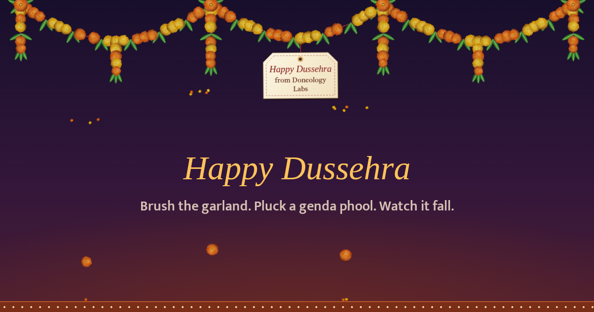

# Dussehra Garland

A marigold toran (genda phool garland with mango leaves) for your screen.

- **Brush it** with your mouse or finger and the flowers sway and spin.
- **Tap or click a genda phool** to pluck it. It falls, bounces and rolls along the floor. Leaves and petals flutter down.
- **Write your own greeting** on the paper tag. Double-tap the tag or use **Edit tag**.
- **Share** sends a link that opens with *your* greeting on the tag.



## Play it

Open the web app from the **Website** link in this repository's *About* panel (top right). It runs in any browser on Android, iPhone, iPad, Windows or Mac.

Nothing to download. The physics runs entirely in your browser.

### Put it on your home screen

| Device | Steps |
|---|---|
| Android (Chrome) | Tap **Install app** in the garland's toolbar, or ⋮ menu → **Add to Home screen** |
| iPhone / iPad (Safari) | Share button → **Add to Home Screen** |
| Windows / Mac (Chrome or Edge) | Install icon at the right end of the address bar |

Once installed it opens full-screen like a regular app and works offline.

## Desktop version (Windows)

`desktop/` holds the original Windows app: a transparent, always-on-top garland that hangs over your whole desktop, with flowers that drop onto the taskbar.

- Ready-made `.exe`: see **Releases**. It is built by GitHub Actions from the code in this repository (`.github/workflows/build-windows.yml`), and a SHA-256 checksum is attached.
- Run from source: install Python 3.10+, then
  ```
  cd desktop
  pip install -r requirements.txt
  python dussehra_garland.py
  ```
- Change the tag text: double-click the tag, right-click a flower → **Change tag text…**, or start with `--text "Shubh Dussehra\nTeam Doneology"`.
- Right-click menu / tray icon: re-string the garland, clear fallen flowers, hover-only mode (clicks pass through to your apps), start with Windows, quit.

## How it works

The garland is a chain of beads joined by distance constraints and integrated with Verlet steps at 120 Hz (position-based dynamics). Your pointer is a small round "fingertip": it pushes beads out of its way and drags them with bounded friction, which also spins the flowers. A plucked flower becomes a free body with gravity, a low bounce (it is a soft ball of petals), rolling resistance and flower-to-flower collisions. Leaves and petals use heavy air drag plus a sideways flutter. The simulation sleeps when everything is at rest, so it costs almost no battery.

## Setup (for the repository owner)

1. Create a public repository named `dussehra-garland` and upload these files (GitHub web: **Add file → Upload files**, drag the whole folder).
2. **Settings → Pages → Build and deployment → Source: GitHub Actions.**
3. Open the **Actions** tab and wait for *Publish web app* to finish. Your link appears on the run and under *Settings → Pages*.
4. On the repository home page, click ⚙ next to **About** and tick **Use your GitHub Pages website**, so visitors find the link at the top.
5. For a Windows `.exe` download: **Releases → Draft a new release**, tag `v1.0.0`, publish. *Build Windows app* attaches the `.exe` and its checksum.

## Repository layout

| Folder | What it holds |
|---|---|
| `web/` | The web app (single `index.html`, manifest, offline service worker) |
| `desktop/` | The Windows app source and build scripts |
| `tools/make_assets.py` | Draws the icons and link-preview image from code; run automatically by the workflow |
| `.github/workflows/` | Publishes the web app to GitHub Pages; builds the Windows `.exe` on release |

## License

MIT. Made by Doneology Labs.
